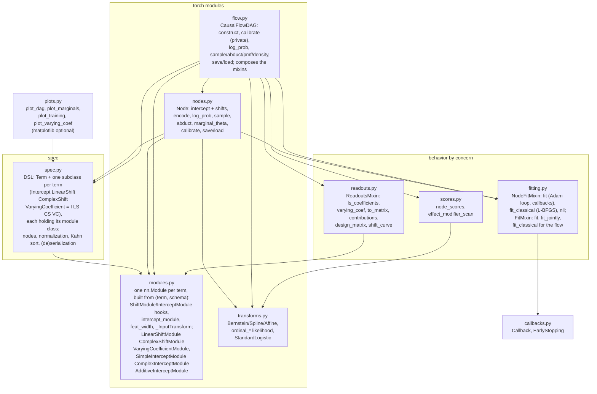
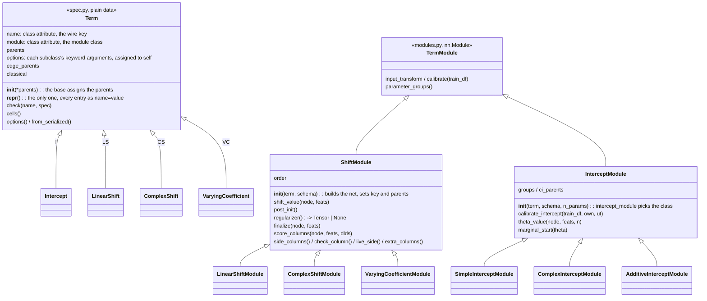

# Architecture

The package has ten modules and one rule. Term-specific behavior lives on the
term's two classes: its `Term` subclass (the spec) and its module in
`modules.py`. Node-kind maths lives in five `Node` methods, `nodes.encode` and
the score derivative in `scores.py` ([scores.md](scores.md)). Everything else is
framework code.

## Module map

`modules.py` imports nothing from `spec.py` at run time: it reads the node's
parent schema, `{parent: "continuous" | n_levels}`, and a term's `parents` and
options. That is what lets each term class hold its module class directly
(`LinearShift.module is LinearShiftModule`). `fitting.py` and `readouts.py` are
mixins: `Node` composes `NodeFitMixin`, and `CausalFlowDAG` composes `FitMixin`
and `ReadoutsMixin`. `fitting` imports `flow` and `nodes` under `TYPE_CHECKING`
only, so the import graph is acyclic at module load.

## The term contract

Each module builds its layers in a fixed order under fixed attribute names.
So the state-dict paths (`nodes.<n>.shifts.<key>.…`) and the seeded RNG stream
are stable. `tests/test_statedict_stability.py` pins them.

A custom term is two classes:

- a `ShiftModule` subclass with `__init__(term, schema)`, which builds the
  network from the parent schema and sets `key`, `parents` and
  `shift_value`;
- a `tramdag.Term` subclass with `name` and `module` as class attributes
  (`__init_subclass__` refuses one without). Its options are the keyword
  arguments of its `__init__`, assigned to `self` after
  `super().__init__(*parents)`; its rules are the checks after that, plus
  `check` and `edge_parents`.

## Node kinds

The two node kinds are continuous and ordinal. The maths that differs by
kind is an if/else in three places.

- The five `Node` methods `log_prob`, `sample`, `abduct`, `marginal_theta` and
  `encode`, plus the transform choice in `Node.__init__`.
- The column encoding `nodes.encode`.
- The score derivative in `scores.py` ([scores.md](scores.md)).

Other code reads a node's schema entry (`nodes.schema_entry`):
`"continuous"` or a level count.

## Guards that pin all of this

- `tests/tools/statedict_smoke.py`: seeded per-DGP state dicts, bit-compared.
- The inline DGP truths (`tests/conftest.py`) and the regex-pinned refusals.
- `experiments/ground_truth/*.json`: the CI-checked replications with
  wall-time tripwires. Centers move only with a documented reason.
